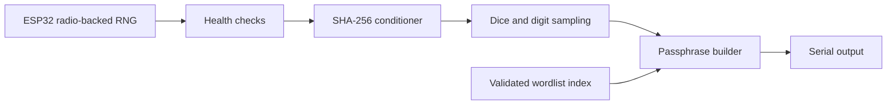

# C source guide

This guide assumes you can read C pointers, structs, callbacks, and basic
RTOS code. Start here for the code map, then use the function comments in
the headers for contracts and the source comments for implementation details.
[DESIGN.md](DESIGN.md) explains architectural choices; [SECURITY.md](SECURITY.md)
describes assumptions and remaining limits.

## Reading order and file map

Read the interface first, the portable generation code second, and the
platform/task integration last. Test fixtures provide concrete examples of
constructing each layer without an ESP32.

| File | Responsibility and what to look for |
| --- | --- |
| [main/rng.h](main/rng.h) | Callback plus context interface. Understand borrowed state, complete-read success, and unusable output after failure. |
| [main/dice.h](main/dice.h) | Sampling ranges, pointer preconditions, and retry/failure contract. |
| [main/dice.c](main/dice.c) | Rejection sampling: discard excess byte values before modulo so choices have equal representation. |
| [main/wordlist.h](main/wordlist.h) | Index layout, backing-text lifetime, parser results, and non-terminated word slices. |
| [main/wordlist.c](main/wordlist.c) | Bounded record parsing, ordered dice codes, base-6 conversion, and direct lookup. |
| [main/passphrase.h](main/passphrase.h) | Output format, capacity macro, error handling, and caller cleanup obligations. |
| [main/passphrase.c](main/passphrase.c) | Draw choices, append groups, check capacity, and erase partial output through a common cleanup path. Also implements `secure_zero()`. |
| [main/health.h](main/health.h) | Streaming test state, cutoffs, failure latch, and checked-source interface. |
| [main/health.c](main/health.c) | Repetition runs and adaptive-proportion windows across read boundaries; erase a whole read if any sample fails. |
| [main/condition.h](main/condition.h) | Hash callback, cached output layout, extra-input lifetime, and the difference between wipe and reset. |
| [main/condition.c](main/condition.c) | Fresh-input refills, partial reads from digest blocks, immediate erasure of consumed bytes, and sticky failures. |
| [main/entropy_radio.h](main/entropy_radio.h) | Boot-only radio lifecycle and the hardware-source adapter contract. |
| [main/entropy_radio.c](main/entropy_radio.c) | ESP-IDF initialization, station events, atomic running flag, and checks around hardware RNG reads. |
| [main/main.c](main/main.c) | Boot ordering, wordlist hash verification, queue producers, task ownership, serial output, and resource-failure handling. |
| [test/test_host.c](test/test_host.c) | Scripted/stuck/random sources, host SHA-256 adapter, parser fixtures, boundary checks, failure cleanup, and statistical checks. |

## How the pieces fit

The arrows below show random-byte consumption. Wordlist data enters the
phrase builder separately; it is not an entropy source.

Each RNG layer exposes the same `rng_t` callback/context pair. Calling
`conditioned_rng_as_rng(&state)` returns a small handle pointing to the
original state, not a cloned generator. A read through that handle can
call through the conditioner, health wrapper, and hardware provider in turn.
The underlying objects must remain alive, and mutable wrappers must not
be read concurrently without external serialization.

`app_main()` builds this chain once. The button ISR and serial task submit
small trigger records to a queue. The generator task consumes them and
owns the mutable RNG state after startup. The GPIO interrupt does not
perform hashing or build a passphrase. The queue copies records by value;
full nonblocking sends can drop triggers.

## Memory ownership and failure handling

The wordlist parser borrows the embedded text and records offsets/lengths.
A lookup returns a slice, not a C string: use the returned length, never
`strlen()` on the word pointer. The index is read-only after successful
initialization. A failed parser result leaves an unusable partial index.

The phrase builder writes into caller-owned storage. Its capacity includes
words, digits, separators, and the final NUL. On failure, supplied writable
output is erased; on success, the generator task owns the phrase until it
prints and wipes it. `secure_zero()` addresses only the supplied memory,
not copies retained by the console driver or host.

A generic RNG failure means the whole requested result is unusable. The
health and conditioner adapters additionally erase that range, including
bytes written before a later failure. The raw radio provider does not
promise to erase failed output itself.

Health and conditioner failures latch: later reads fail rather than retry
with weaker randomness. `conditioned_rng_wipe()` erases buffered bytes and
supplemental input but preserves the failure flag and source configuration.
Initialization resets a wrapper's state; it does not repair its underlying
source. Normal firmware recovery from an entropy failure is a reset.

Hashing and passing health tests do not establish an entropy lower bound.
The strength estimates rely on source assumptions and independent uniform
choices. Wordlist parsing checks structure; the pinned SHA-256 verifies
identity with the expected EFF file.

## Working with the tests

Run `make -C test`. The portable test binary uses OpenSSL for SHA-256 and
`/dev/urandom` for varied test input. It does not start Wi-Fi, run ESP-IDF
tasks, or measure the device's hardware entropy. If the real wordlist is
available, it is used after the malformed/synthetic parser fixtures.

The sequence source can exhaust after partially filling a buffer, while
the constant source models a stuck generator. These fixtures make failure
cleanup and exact sampling boundaries repeatable. The chi-squared checks
use random samples and can fail by chance; they complement deterministic
checks rather than proving uniformity or device security.

For a change to the pipeline, read the corresponding header contract and
its test fixture together. Pay particular attention to borrowed lifetimes,
state carried across reads, NUL-versus-length handling, and output cleanup.
