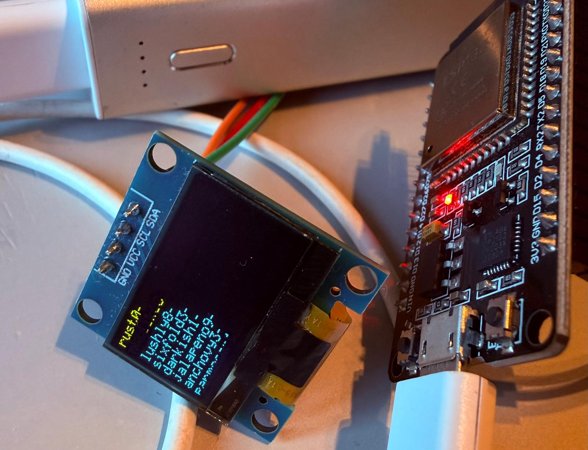

# passu - ESP32 diceware generator



> [!CAUTION]
> This is a proof of concept. It works and is tested, but it has not had an
> independent security review. There are no guarantees of security or of the
> quality of the generated data. All code is generated by Claude Code.

A small hardware diceware passphrase generator for the ESP32. *Passu* is
Finnish slang for "password". It builds passphrases from the
[EFF large wordlist](https://www.eff.org/dice) using the chip's hardware
random number generator:

1. Clone the repo.
2. Build the firmware.
3. Flash the board.
4. Press BOOT, or run `passu` on the computer.
5. Get your passphrase over USB serial, or on an optional OLED display.

How it is built and why: [DESIGN.md](DESIGN.md). Every security measure, the
optional device lockdown and the known gaps: [SECURITY.md](SECURITY.md). A
one-page quick reference: [USAGE.md](USAGE.md).

## Contents

- [Passphrase length and entropy](#passphrase-length-and-entropy)
- [How it works](#how-it-works)
- [Requirements](#requirements)
- [Build and flash](#build-and-flash)
- [Using it](#using-it)
- [Configuration](#configuration)
- [OLED display (optional)](#oled-display-optional)
- [Locking down a device](#locking-down-a-device)
- [Tests](#tests)
- [Troubleshooting](#troubleshooting)
- [License](#license)

## Passphrase length and entropy

By default a passphrase has 8 groups. Each group is one EFF word (five d6
rolls, about 12.9 bits) plus one random digit (about 3.3 bits), so a group is
worth about 16.2 bits and the whole passphrase about **130 bits**.

You don't have to use all eight groups. Each group is picked independently, so
you can take the first *n* groups and leave the rest. Don't pick the groups you
like best, because that makes the result less random.

| Length | Words only | passu groups | Note |
| --- | --- | --- | --- |
| 4 | ~52 bits | ~65 bits | |
| 5 | ~65 bits | ~81 bits | |
| 6 | ~78 bits | ~97 bits | [EFF recommendation](https://www.eff.org/dice) |
| 7 | ~90 bits | ~114 bits | |
| 8 | ~103 bits | ~130 bits | passu default |

"Words only" is what you get if you leave the digits out. The number of groups
the firmware generates can be changed in `idf.py menuconfig` → *passu* →
*Number of word+digit groups* (5–16).

## How it works

1. **Hardware RNG.** ESP-IDF documents that
   [`esp_fill_random()`](https://docs.espressif.com/projects/esp-idf/en/stable/esp32/api-reference/system/random.html)
   gives true random numbers only while the RF subsystem is running. The
   firmware starts Wi-Fi in station mode and **never connects or scans**; the
   radio just listens. If it stops, random reads fail instead of quietly
   falling back to pseudo-random output.
2. **Health tests.** Every byte goes through the repetition count and adaptive
   proportion tests from
   [NIST SP 800-90B](https://csrc.nist.gov/pubs/sp/800/90/b/final), plus a
   1024-byte test at boot. These catch a stuck or badly biased source. They
   are a tripwire, not proof of entropy.
3. **SHA-256 conditioning.** Each 32-byte output block is the SHA-256 of 128
   fresh raw bytes plus the CPU cycle count at the moment of the trigger.
   Nothing carries over between blocks.
4. **Rejection sampling.** `byte % 6` would favor some faces because 256 isn't
   a multiple of 6. Bytes 252 and up are thrown away for dice rolls, and 250
   and up for digits.
5. **EFF wordlist.** Five rolls such as `24315` pick one of 7776 words. The
   list is built into the firmware; its SHA-256 is pinned at build time and
   checked again at boot, along with every line.
6. **Output.** The passphrase goes to the serial port, to an optional OLED, or
   both. Then every buffer is wiped.

If any check fails, the device latches an error and refuses to generate
anything until it is reset. No passphrase is better than a bad one.

[DESIGN.md](DESIGN.md) has the full pipeline, with the numbers behind each
step and the alternatives that were rejected.

## Requirements

**Hardware**

- An ESP32 dev board. Tested with a classic ESP32 (ESP32-D0WD-V3). Other
  variants with Wi-Fi (S3, C3, …) may work after `idf.py set-target`, but
  that is untested, and the lockdown profile is for the classic ESP32 only.
- A USB **data** cable. Charge-only cables don't work.
- Optional: a 128x64 or 128x32 I2C OLED display (see
  [OLED display](#oled-display-optional)).

**Software**

- [ESP-IDF](https://docs.espressif.com/projects/esp-idf/) v6.1 (v5.3 or
  later should also work; earlier versions lack the `esp_driver_*`
  components the build uses).
- Git, to clone the repository.
- Python 3 with `pyserial` for the host command.
- Linux. macOS should work too; other platforms are untested.

**Linux serial port access:** your user must be in the `dialout` group. Log
out and back in afterwards:

```bash
sudo usermod -aG dialout $USER
```

## Build and flash

The firmware is a standard ESP-IDF project: `idf.py` configures, builds and
flashes it. Run every command from the **project root** (the directory with
this README), not from `main/`.

### 1. Install ESP-IDF

Install ESP-IDF v6.1 once, with either method:

- **ESP-IDF Installation Manager (`eim`)**, Espressif's current installer.
  It puts ESP-IDF and its tools under `~/.espressif`:

  ```bash
  eim install -i v6.1
  ```

  Running `eim` with no arguments starts an interactive wizard instead.
- **Manual git checkout**, the classic method:

  ```bash
  git clone -b v6.1 --recursive https://github.com/espressif/esp-idf.git ~/esp/esp-idf
  ~/esp/esp-idf/install.sh esp32
  ```

Both are described in Espressif's
[Get Started guide](https://docs.espressif.com/projects/esp-idf/en/stable/esp32/get-started/),
including the system packages each platform needs first.

### 2. Clone passu

```bash
git clone https://github.com/jerQ/passu.git
cd passu
```

The EFF wordlist is part of the repository; there is nothing else to
download.

### 3. Load the environment

Each new shell needs the ESP-IDF environment (`IDF_PATH`, the compilers, and
the Python environment that provides `idf.py`):

```bash
source ~/.espressif/tools/activate_idf_v6.1.sh    # eim
. ~/esp/esp-idf/export.sh                          # manual checkout
```

Check it with `idf.py --version`, which should print `ESP-IDF v6.1`.

### 4. Select the chip

Once per checkout. This creates `sdkconfig` and wipes the build directory:

```bash
idf.py set-target esp32          # other chips are untested
```

### 5. Configure (optional)

The defaults in `sdkconfig.defaults` work as they are: no display, 8 groups,
button on GPIO0. To change something, for example to enable the OLED, open
the configuration menu:

```bash
idf.py menuconfig                # → passu
```

The options are listed under [Configuration](#configuration).

### 6. Build

```bash
idf.py build
```

The build checks the wordlist (`main/eff_large_wordlist.txt`) against the
SHA-256 pinned in `DW_WORDLIST_SHA256`, and fails if it doesn't match. The
result is in `build/`: `build/bootloader/bootloader.bin`,
`build/partition_table/partition-table.bin` and the app, `build/passu.bin`.

### 7. Flash and monitor

Connect the board over USB, then:

```bash
idf.py -p /dev/ttyUSB0 -b 115200 flash monitor
```

- **Port:** usually `/dev/ttyUSB0` (CP210x, CH34x, FTDI) or `/dev/ttyACM0`
  (boards with native USB). `ls /dev/ttyUSB* /dev/ttyACM*` lists them.
- **`-b 115200`** is slower than the default but avoids the flashing failures
  some boards and USB-serial adapters have at higher speeds.
- **Stuck at `Connecting...`** or `No serial data received`: some boards can't
  enter download mode on their own. Hold **BOOT** while it connects, and
  release it once writing starts.
- **Leave the monitor** with **Ctrl+]**, or **Ctrl+T** then **Ctrl+X** (see
  [Serial monitor](#serial-monitor)). Close it before running `passu`, since
  only one program can use the port at a time.

On boot you should see:

```text
passu - ESP32 diceware passphrase generator (proof of concept)
Wordlist: 108800 bytes, SHA-256 <hash>
Wordlist: 7776 entries validated, longest word <n> chars
Entropy: radio running, startup health test passed
Press the button on GPIO0 or Enter for a passphrase (8 groups, ~130 bits)
```

With a display, the banner also shows the controller, size and address, for
example `Display: SSD1306 128x64 at I2C 0x3c (8-bit 0x78), SDA GPIO21, SCL
GPIO22`.

### Useful `idf.py` commands

| Command | What it does |
| --- | --- |
| `idf.py build` | Build only |
| `idf.py -p PORT flash` | Build if needed, then flash |
| `idf.py -p PORT monitor` | Serial monitor; resets the board when it opens |
| `idf.py menuconfig` | Change the configuration |
| `idf.py size` | Show how much flash and RAM the app uses |
| `idf.py fullclean` | Delete the build directory, for a clean rebuild |
| `idf.py set-target esp32` | Change the chip; wipes the build |

### sdkconfig and sdkconfig.defaults

| File | What it is | In git? |
| --- | --- | --- |
| `sdkconfig` | The full, generated configuration. `menuconfig` and `set-target` write it | No, ignored |
| `sdkconfig.defaults` | Short, hand-written list of the options this project changes from ESP-IDF's defaults | Yes |
| `sdkconfig.secure` | Opt-in lockdown profile. **Burns eFuses permanently**; see [Locking down a device](#locking-down-a-device) | Yes |

When `sdkconfig` doesn't exist, ESP-IDF creates it from its own defaults with
`sdkconfig.defaults` applied on top, so a fresh clone builds with the
project's settings. **Once `sdkconfig` exists, it wins**: editing
`sdkconfig.defaults` has no effect until you regenerate it with `rm sdkconfig`
and `idf.py set-target esp32`.

Changes made in `menuconfig` only go to `sdkconfig`, so they are lost on a
fresh clone or after `rm sdkconfig`. To keep one, copy the line into
`sdkconfig.defaults` by hand. The option names are in `main/Kconfig.projbuild`
with a `CONFIG_` prefix:

```ini
CONFIG_DW_GROUPS=10
CONFIG_DW_BUTTON_GPIO=4
CONFIG_DW_SERIAL_TRIGGER=n
```

### Several configurations side by side

To keep more than one configuration (for example with and without a display)
without overwriting `build/` and `sdkconfig`, give each its own build
directory and config file. Extra settings go in a small file layered on top
of the defaults:

```bash
printf 'CONFIG_DW_DISPLAY=y\n' > display.cfg
idf.py -B build-display -D SDKCONFIG=build-display/sdkconfig \
       -D SDKCONFIG_DEFAULTS="sdkconfig.defaults;display.cfg" build
idf.py -B build-display -D SDKCONFIG=build-display/sdkconfig -p /dev/ttyUSB0 flash
```

## Using it

Short version for a default build: [USAGE.md](USAGE.md).

### BOOT button

Press BOOT (GPIO0) on the board. The passphrase appears in the serial monitor,
on the OLED, or both.

### Host command

`tools/passu.py` finds the board by its USB-serial chip, asks for a passphrase
over serial and prints only that to stdout. Install it once (Fedora shown;
elsewhere use `pip install --user pyserial`):

```bash
sudo dnf install python3-pyserial
chmod +x tools/passu.py
ln -s "$PWD/tools/passu.py" ~/.local/bin/passu
```

Then plug in the board and run:

| Command | Result |
| --- | --- |
| `passu` | One passphrase |
| `passu -n 3` | Three passphrases, one per line; no button press needed |
| `passu -s` | Groups separated by spaces instead of `-` |
| `passu --copy` | To the clipboard instead of the terminal (with `-n`, only the last one stays) |
| `passu --button` | Wait for a BOOT press for each passphrase instead of asking over serial |
| `passu -p /dev/ttyACM0` | Use a specific serial port (or set `PASSU_PORT`) |

How it behaves:

- **Finds the board** by its USB-serial chip (CP210x, CH34x, FTDI, or
  Espressif native USB). If there are several, pick one with `--port`.
- **Doesn't reset the board** when it opens the port, and ignores anything the
  board printed before the command started.
- **Needs the serial trigger** (*Generate on Enter in serial console*, on by
  default). If it is turned off in the firmware, use `--button`.
- **Fixed timeouts.** A serial request gives up after **5 seconds**.
  `--button` waits for each press until you press Ctrl+C.
- **Keeps stdout clean.** Only passphrases go to stdout; prompts and errors go
  to stderr, so `passu > file` and `passu | cmd` pass on just the passphrase.
- **Fails loudly.** A health-test failure, a crash notice, no answer, an
  unplugged board, or a passphrase shown only on the display all exit with a
  non-zero status and no passphrase.
- `--copy` uses `wl-copy` (Wayland), `xclip` or `xsel`, whichever is
  installed.

### Serial monitor

In `idf.py monitor`, press **BOOT** or **Enter** to generate. A BOOT press
prints the bare passphrase, one per line. Enter (which is what the host
command sends) prints it with a tag instead. Status and errors are always
tagged:

```text
<passphrase>                                          (BOOT press)
PASSPHRASE: <passphrase>                              (Enter / host command)
PASSPHRASE-ERROR: <reason>
PASSPHRASE-DISPLAYED: shown on the device display     (serial printing off)
DEVICE-ERROR: <reason>                                (crash notice at boot)
```

**Exiting the monitor:** the default is **Ctrl+]**. **Ctrl+T, then Ctrl+X**
always works too. To remap the exit key to Ctrl+X, create
`~/.config/esp-idf-monitor/esp-idf-monitor.cfg`:

```ini
[esp-idf-monitor]
exit_key = X
```

## Configuration

Run `idf.py menuconfig` → *passu*:

| Option | Default | Description |
| --- | --- | --- |
| Trigger button GPIO | `0` | Button to GND; GPIO0 is the BOOT button on most boards |
| Number of word+digit groups | `8` | 5–16; about 16.25 bits each |
| Generate on Enter in serial console | on | Needed for `passu` without `--button` |
| Expected SHA-256 of wordlist | EFF list's hash | Build fails and boot halts if the list doesn't match; empty skips the check |

`sdkconfig.defaults` also sets security-related ESP-IDF options (log level,
core dumps, silent reboot on a crash, Wi-Fi storage); see
[SECURITY.md](SECURITY.md).

## OLED display (optional)

With a display, passu doesn't need a computer at all. Power it from a USB
charger, press the button, and read the passphrase off the screen. For
passphrases the computer must never see, turn serial printing off: the
passphrase then only ever exists on the device.

Supported are the common 128-pixel-wide monochrome I2C modules:

| Module | Controller | Setting |
| --- | --- | --- |
| 0.96" 128x64, 0.91" 128x32 | SSD1306 | SSD1306 / SSD1309 |
| 2.42" 128x64 | SSD1309 | SSD1306 / SSD1309 |
| 1.3" 128x64 | SH1106 (usually) | SH1106 |

If a 1.3" module shows a stripe of noise at one edge, or the image is shifted
by 2 pixels, switch the controller setting.

**Wiring** (default pins, changeable in menuconfig):

| Display | ESP32 |
| --- | --- |
| VCC | 3V3 |
| GND | GND |
| SDA | GPIO21 |
| SCL | GPIO22 |

Enable it in `idf.py menuconfig` → *passu* → *OLED display*, or in
`sdkconfig.defaults`:

```ini
CONFIG_DW_DISPLAY=y
CONFIG_DW_DISPLAY_SH1106=y        # only for SH1106 modules
CONFIG_DW_SERIAL_PASSPHRASE=n     # keep passphrases off the serial port
```

| Option | Default | Description |
| --- | --- | --- |
| Display controller | SSD1306 / SSD1309 | Or SH1106 |
| Display size | 128x64 | 128x32 fits up to 8 groups |
| I2C address | `0x3C` | 7-bit address; some modules use `0x3D`. A module marked `0x78` is `0x3C`, and `0x7A` is `0x3D` |
| SDA / SCL GPIO | `21` / `22` | |
| Rotate 180 degrees | off | |
| Clear the passphrase after | 60 s | 5–600 s |
| Also print passphrases over serial | on | Turn off to keep passphrases off the computer |

How it behaves:

- **Layout:** on a 128x64 display each group gets its own line, hyphen
  included, so you can type it straight off the screen. With more groups than
  lines (or on 128x32), two groups share a line.
- **Clearing:** the passphrase clears after the timeout, or at once when you
  press the button while it is shown. The next press makes a new one. Enter in
  the serial console (and `passu`) always makes a new one.
- **Serial printing off:** the serial port only says `PASSPHRASE-DISPLAYED`,
  and `passu` reports that the passphrase is on the display. If the display
  isn't found at boot, the board halts, since passphrases would have nowhere
  to go. With serial printing on, it logs a warning and carries on without the
  display.

## Locking down a device

Out of the box, anyone with USB access can flash different firmware onto the
board, and firmware that prints passphrases the attacker knows would look
exactly like passu. The opt-in lockdown profile (`sdkconfig.secure`) enables
Secure Boot V2 and turns off USB flashing.

> [!WARNING]
> Lockdown burns eFuses inside the chip, which can never be undone. Read
> [Locking down a device](SECURITY.md#locking-down-a-device) in SECURITY.md,
> which lists each step and what it costs, before you build it.

## Tests

The platform-independent code (health tests, conditioning, dice, wordlist,
passphrase builder, display layout) has a host test suite that runs with
AddressSanitizer and UndefinedBehaviorSanitizer. It needs OpenSSL's headers
for SHA-256 (Fedora: `openssl-devel`):

```bash
make -C test
```

What the tests cover, and why: [DESIGN.md](DESIGN.md#testing).

## Troubleshooting

| Problem | Fix |
| --- | --- |
| `Missing main/eff_large_wordlist.txt` | The committed list was deleted: `git checkout main/eff_large_wordlist.txt` |
| `doesn't seem to be a CMake build directory` | You ran `idf.py` inside `main/`. `cd ..`, then `rm -rf main/build` |
| `Failed to start stub flasher` / stuck at `Connecting...` / `Failed to connect to ESP32: No serial data received` | Use `-b 115200`; try another cable or a port without a hub; hold BOOT while it connects |
| `Permission denied: /dev/ttyUSB0` | Join the `dialout` group (see [Requirements](#requirements)) |
| No `/dev/ttyUSB*` or `/dev/ttyACM*` appears | Charge-only cable, or the board needs a different USB port |
| `passu`: port busy | Close `idf.py monitor` |
| `passu`: several possible devices | Pick one with `--port` |
| `no display at I2C address ...` | The boot log then lists what the I2C scan found. `device at 0x3d`: set that address in menuconfig. No devices: check wiring (a loose or broken wire is the usual cause) and 3.3 V power. A 7-pin module (D0/D1/RES/DC/CS) ships in SPI mode; for I2C it needs its resistors moved, RES tied high, DC and CS to GND |
| OLED stays dark, no error in the boot log | The display answers but shows nothing: try the other controller (SSD1306 / SH1106) in menuconfig |
| `PASSPHRASE-ERROR: entropy health failure` | Reset the board. If it repeats, the RNG or radio isn't working; don't use the device |
| `DEVICE-ERROR: previous run crashed` | The device crashed and restarted; no passphrase was produced. Try again. If it repeats, don't use the device |
| Change in `sdkconfig.defaults` has no effect | An existing `sdkconfig` overrides it: `rm sdkconfig`, then `idf.py set-target esp32` and rebuild |
| Wordlist hash mismatch (build or boot) | The list differs from the pinned hash: `git checkout main/eff_large_wordlist.txt`, then rebuild |
| `Secure Boot is enabled but not acknowledged` | You are building the lockdown profile. Read [Locking down a device](SECURITY.md#locking-down-a-device) before setting `CONFIG_DW_LOCKDOWN_ACK` |

## License

This project is licensed under the [MIT License](LICENSE), except for the
following:

- **EFF large wordlist** (`main/eff_large_wordlist.txt`): by the Electronic
  Frontier Foundation, included unchanged under
  [CC BY 3.0 US](https://creativecommons.org/licenses/by/3.0/us/). See the
  [EFF's diceware page](https://www.eff.org/dice) and
  [copyright policy](https://www.eff.org/copyright).
- **Display font** (`main/font6x8.h`, generated by `tools/gen_font.py`):
  drawn for this project and dedicated to the public domain.
